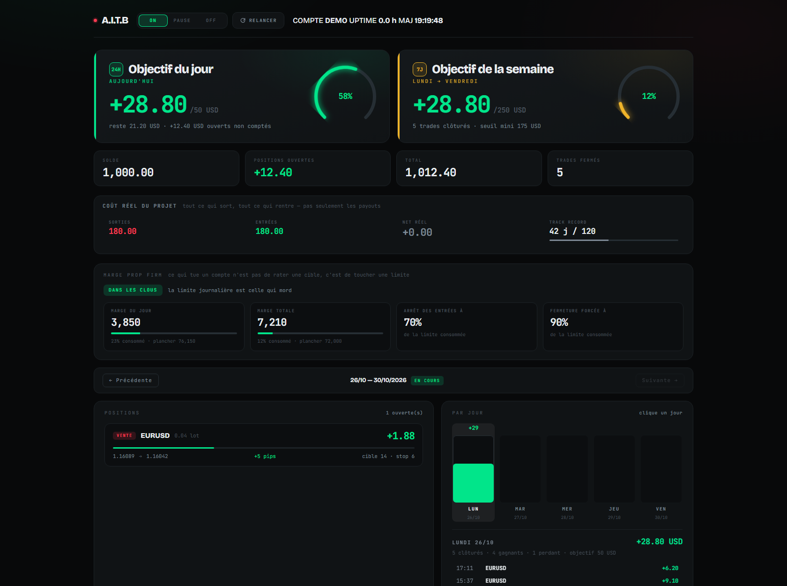

# A.I.T.B — Artificial Intelligence Trading Bot

Bot de trading autonome sur MetaTrader 5, écrit en Python, avec moteur de backtest,
garde-fou prop firm et tableaux de bord temps réel.

Le projet a connu deux générations. La première envoyait des captures d'écran de
MetaTrader 5 à ChatGPT, lisait la réponse à l'écran par OCR et en tirait une décision
BUY / SELL / NOTHING. La seconde a supprimé le LLM de la boucle live : une IA cherche
des stratégies hors ligne et les backteste en masse, le bot n'exécute plus qu'une règle
déterministe et figée. Le code des deux générations est ici, la première est marquée
LEGACY.

> Dépôt public à titre de vitrine. Ce n'est pas un logiciel open source et ce n'est pas
> un conseil en investissement. Voir [Licence](#licence) et [Avertissement](#avertissement).

---

## Aperçu

### Tableau de bord hebdomadaire

Objectif du jour et de la semaine, marge restante avant les limites de la prop firm,
positions ouvertes, détail jour par jour, journal du bot en direct.



### Suivi des trades et du Multi-TP

Un trade par ligne, du cycle de décision jusqu'à la clôture, avec les trois niveaux de
take profit et le stop suivi en continu.


Les deux captures sont générées à partir de **données fictives**, par
`outils/apercu_demo.py` et `docs/exemples/dashboard_demo.html`. Aucun relevé de compte
réel n'est publié ici.

---

## Ce que fait le bot

| Étage | Rôle |
|---|---|
| **Données de marché** | Lecture OHLC via l'API Python MT5, cache CSV local, aucun appel payant |
| **Indicateurs** | SMA, EMA, RSI, ATR, ADX, Donchian, Bollinger, Keltner, MACD, en numpy pur |
| **Stratégies** | Règles déterministes paramétrées, avec grilles pour le sweep |
| **Backtest** | Moteur bougie par bougie, frais et spread inclus, métriques complètes |
| **Recherche** | Sweep massif, walk forward, test de significativité contre le hasard |
| **Exécution** | Envoi d'ordres MT5, gestion du filling mode, Multi-TP en thread séparé |
| **Suivi** | Passage au point mort, trailing stop, détection de clôture, journal JSON |
| **Risque** | Calcul du lot selon le risque en devise, filtres de spread, de session et d'ATR |
| **Prop firm** | Garde-fou qui coupe les entrées puis ferme tout avant la limite de perte |
| **Supervision** | Watchdog, heartbeat, préflight au démarrage, tableaux de bord HTTP |

### La grille d'acceptation

Une stratégie n'a le droit de passer en forward test que si elle réunit les quatre
conditions suivantes :

- au moins **100 trades** sur le backtest
- **drawdown maximum inférieur à 20 %**
- **profit factor supérieur à 1.3**
- elle **bat le buy and hold** de l'instrument

Le win rate ne fait pas partie des critères. Une stratégie à 34 % de trades gagnants peut
être excellente si le rapport gain sur perte est à l'endroit. Ces seuils viennent d'un
retour d'expérience sur environ 2000 backtests, dont la grande majorité a échoué une fois
en conditions réelles.

---

## Arborescence

```
aitb/                  coeur du bot
  live.py              runner headless, stratégie déterministe
  market_data.py       lecture OHLC MT5 + cache CSV
  indicators.py        indicateurs techniques en numpy pur
  strategies.py        stratégies et grilles de paramètres
  backtest.py          moteur de backtest
  trade_manager.py     envoi d'ordres, filling mode, thread Multi-TP
  monitor.py           point mort, trailing, détection de clôture
  logger.py            journal JSON et génération du dashboard HTML
  risk_manager.py      calcul du lot et validation du volume
  filters.py           filtres de spread, de session, d'ATR, de cooldown
  propfirm_guard.py    garde-fou de la prop firm
  preflight.py         vérifications au démarrage
  watchdog.py          redémarrage automatique
  arb_*.py, okx.py     branche crypto, arbitrage de financement
  main.py              LEGACY, capture d'écran MT5 et exécution
  scheduler.py         LEGACY, boucle de cycles
  read_chatgpt_output.py  LEGACY, macro souris et OCR Tesseract
config/settings.py     configuration centrale
research/              sweep, walk forward, Monte Carlo, liquidité, funding
utils/                 journalisation horodatée, couleurs, bannière
outils/                scripts de test et de diagnostic, hors production
scripts/               fichiers .bat du poste de travail Windows
serveur/               variante serveur : dashboard, envoi, tâches planifiées
docs/                  architecture détaillée, captures, exemples
dashboard.py           tableau de bord hebdomadaire, port 8080
dashboard_crypto.py    tableau de bord de la branche crypto, port 8081
run.py                 point d'entrée du bot
```

## Stack

Python 3.12, MetaTrader 5 (API Python), numpy, pandas, pytesseract et Tesseract OCR
(branche LEGACY), pyautogui et pywin32 (branche LEGACY), `http.server` pour les
tableaux de bord, HTML / CSS / JavaScript sans aucune dépendance front.

## Documentation

[`docs/ARCHITECTURE.md`](docs/ARCHITECTURE.md) est le document de référence du projet :
chaque module, chaque fichier de configuration, chaque piège rencontré et la raison des
choix. C'est le fichier que je lis en premier quand je reprends le code après deux
semaines d'absence.

Quelques enseignements qui y sont consignés :

- les comptes RAW d'IC Markets refusent le filling mode FOK et exigent IOC
- les restrictions de volume dépendent du solde du compte, pas seulement du levier
- une sortie console bavarde rend le bot inutilisable, seuls les événements significatifs
  méritent une ligne
- un système Multi-TP a besoin de drapeaux d'état explicites, sinon l'affichage ment
- un LLM dans la boucle live n'est pas backtestable, puisqu'il ne répond jamais deux fois
  la même chose

## Ce que ce dépôt ne contient pas

Volontairement retirés avant publication :

- identifiants et mots de passe de courtier, fichiers `.env`, jetons d'envoi
- numéros de compte, adresses du réseau privé, URL de déploiement
- historiques de marché téléchargés, environ 1 Go de CSV régénérables avec
  `research/sweep.py --download`
- journaux de trading réels, captures d'écran de sessions, profil de navigateur
- environnement virtuel et caches

Le dépôt n'est donc pas exécutable tel quel. Il est là pour être lu.

## Licence

Tous droits réservés. Le code est rendu **visible**, pas réutilisable : aucune licence
open source n'est accordée, ni pour la copie, ni pour la modification, ni pour un usage
commercial ou personnel.

## Avertissement

Le trading sur marge comporte un risque de perte élevé. Ce dépôt documente un projet
personnel d'ingénierie, il ne constitue ni un conseil en investissement, ni une promesse
de performance, ni une invitation à reproduire la démarche avec de l'argent réel.
