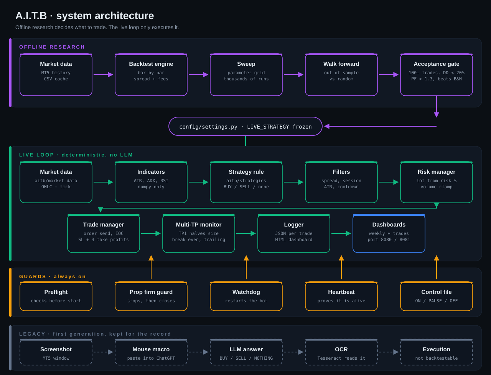
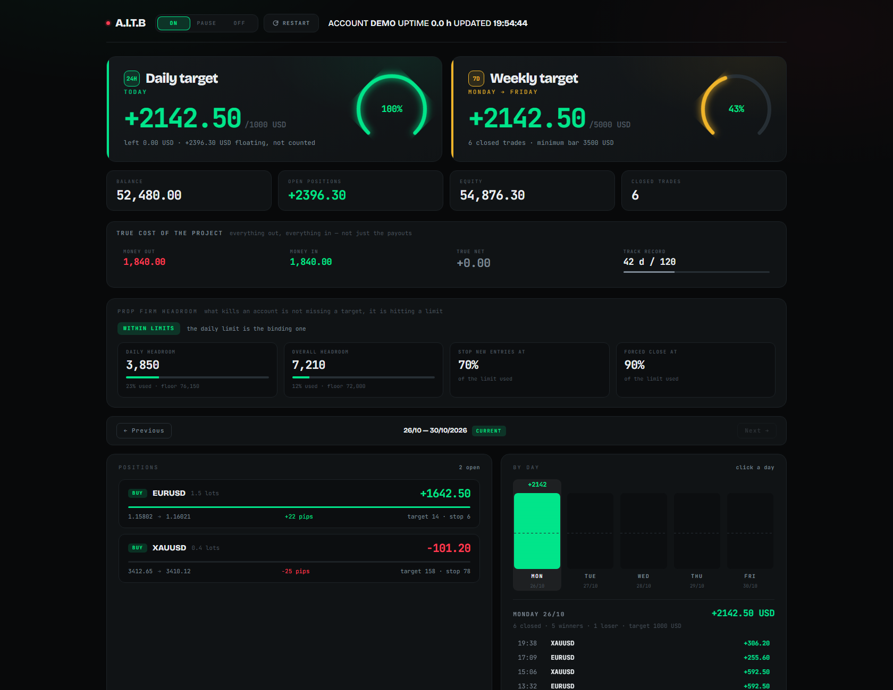
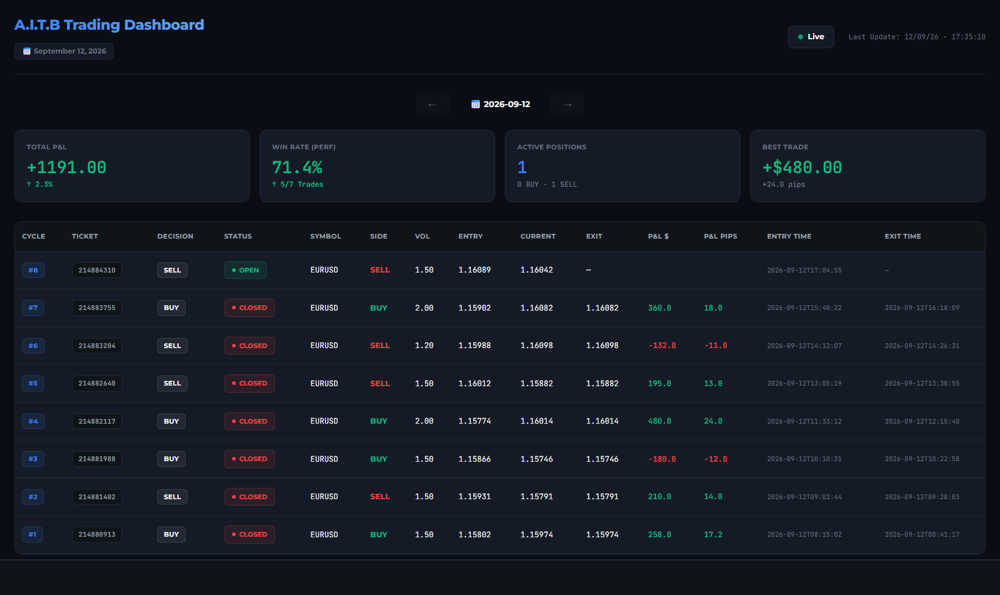
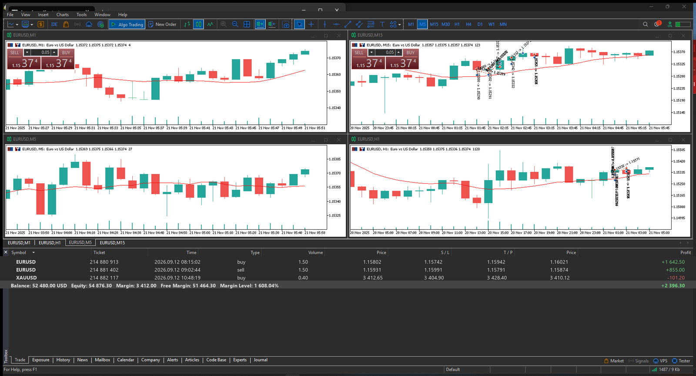

# A.I.T.B — Artificial Intelligence Trading Bot

An autonomous trading bot for MetaTrader 5, written in Python, with its own
backtesting engine, a prop firm guard rail and real time dashboards.

The project went through two generations. The first one sent MetaTrader 5
screenshots to ChatGPT, read the answer off the screen with OCR and turned it
into a BUY / SELL / NOTHING decision. The second one took the LLM out of the
live loop: research happens offline, strategies are backtested in bulk, and the
bot only executes a frozen deterministic rule. Both generations are in this
repository, the first one marked LEGACY.

> Public as a showcase. This is not open source software and it is not
> investment advice. See [License](#license) and [Disclaimer](#disclaimer).

---

## Architecture



The split is the whole point. Anything that needs judgement happens offline,
where it can be measured. Anything that runs with money on the line is a rule
that cannot change its mind.

---

## Screenshots

### Weekly dashboard

Daily and weekly targets, headroom left before the prop firm limits, open
positions, a day by day breakdown and the live log of the bot.



### Trade and Multi-TP tracking

One row per trade, from the decision cycle through to the close, with the three
take profit levels and the stop as it moved.



### MetaTrader 5 terminal

The bot drives a standard MT5 terminal through the official Python API. The
charts here are an actual capture taken by the bot.



All three are rendered from **fictional data** by `tools/demo_preview.py`,
`tools/demo_trades.py` and `tools/make_mt5_screenshot.py`. No real account
statement, balance or trade history is published in this repository.

---

## What the bot does

| Layer | Role |
|---|---|
| **Market data** | OHLC through the MT5 Python API, local CSV cache, no paid feed |
| **Indicators** | SMA, EMA, RSI, ATR, ADX, Donchian, Bollinger, Keltner, MACD, in pure numpy |
| **Strategies** | Parameterised deterministic rules, with grids for the sweep |
| **Backtest** | Bar by bar engine, spread and fees included, full metrics |
| **Research** | Mass sweep, walk forward, significance testing against random entries |
| **Execution** | MT5 order sending, filling mode handling, Multi-TP in its own thread |
| **Monitoring** | Break even move, trailing stop, close detection, JSON journal |
| **Risk** | Lot sizing from currency risk, spread, session and ATR filters |
| **Prop firm** | Guard that stops new entries, then closes everything, before the limit |
| **Supervision** | Watchdog, heartbeat, preflight checks, HTTP dashboards |

### The acceptance gate

A strategy is only allowed into forward testing if it clears all four of these:

- at least **100 trades** in the backtest
- **maximum drawdown under 20%**
- **profit factor above 1.3**
- it **beats buy and hold** on the same instrument

Win rate is not one of the criteria. A strategy that wins 34% of its trades can
be excellent if the ratio between wins and losses points the right way. These
thresholds come out of roughly 2000 backtests, most of which failed once they
met live conditions.

## Layout

```
aitb/                  bot core
  live.py              headless runner, deterministic strategy
  market_data.py       MT5 OHLC reads and CSV cache
  indicators.py        technical indicators, pure numpy
  strategies.py        strategies and parameter grids
  backtest.py          backtesting engine
  trade_manager.py     order sending, filling mode, Multi-TP thread
  monitor.py           break even, trailing, close detection
  logger.py            JSON journal and HTML dashboard generation
  risk_manager.py      lot sizing and volume validation
  filters.py           spread, session, ATR and cooldown filters
  propfirm_guard.py    prop firm guard rail
  preflight.py         start up checks
  watchdog.py          automatic restart
  arb_*.py, okx.py     crypto branch, funding rate arbitrage
  main.py              LEGACY, MT5 screenshot and execution
  scheduler.py         LEGACY, cycle loop
  read_chatgpt_output.py  LEGACY, mouse macro and Tesseract OCR
config/settings.py     central configuration
research/              sweep, walk forward, Monte Carlo, liquidity, funding
utils/                 timestamped logging, colors, banner
tools/                 test and diagnostic scripts, plus the doc generators
scripts/               Windows workstation .bat files
server/                server variant: dashboard, push, scheduled tasks
docs/                  detailed architecture, images, examples
dashboard.py           weekly dashboard, port 8080
dashboard_crypto.py    crypto branch dashboard, port 8081
run.py                 bot entry point
```

## Stack

Python 3.12, MetaTrader 5 (Python API), numpy, pandas, pytesseract and
Tesseract OCR (LEGACY branch), pyautogui and pywin32 (LEGACY branch),
`http.server` for the dashboards, plain HTML, CSS and JavaScript with no front
end dependency at all.

## Documentation

[`docs/ARCHITECTURE.md`](docs/ARCHITECTURE.md) is the reference document for the
project: every module, every configuration file, every trap hit along the way
and the reasoning behind the choices. It is written in French, and it is the
file I read first whenever I come back to the code after two weeks away.

A few of the lessons recorded in it:

- IC Markets RAW accounts reject the FOK filling mode and require IOC
- volume restrictions depend on account balance, not just on leverage
- a chatty console makes the bot unusable, only meaningful events deserve a line
- a Multi-TP system needs explicit state flags, otherwise the display lies
- an LLM inside the live loop cannot be backtested, since it never answers the
  same thing twice

## What this repository does not contain

Deliberately stripped before publishing:

- broker credentials and passwords, `.env` files, deployment tokens
- account numbers, private network addresses, deployment URLs
- downloaded market history, about 1 GB of CSV, regenerable with
  `research/sweep.py --download`
- real trading journals, session screenshots, browser profile
- virtual environment and caches

The repository is therefore not runnable as is. It is here to be read.

## License

All rights reserved. The code is made **visible**, not reusable: no open source
license is granted, for copying, for modification, or for commercial or
personal use.

## Disclaimer

Margin trading carries a high risk of loss. This repository documents a personal
engineering project. It is not investment advice, not a performance claim, and
not an invitation to reproduce any of it with real money.
